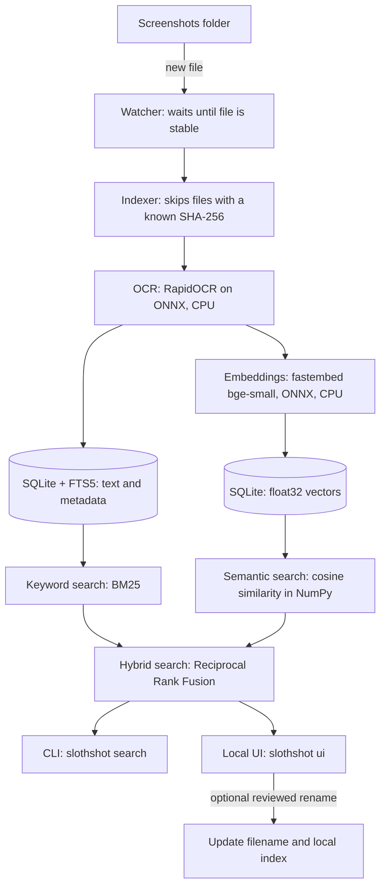

# SlothShot 🦥

**A lazy librarian for your screenshots. It reads them, remembers them, and finds them by the words you remember or by what they were about. All on your own computer, with the Wi-Fi off.**

Private, offline screenshot search for Windows. Find images by exact OCR text or semantic meaning with local OCR and embeddings.

🎬 **Demo walkthrough and recording script:** [`docs/DEMO.md`](docs/DEMO.md).

You take a screenshot of an error, a chat, a recipe, a bank page. Three weeks later you remember *"that Docker port thing"*, not the file name. SlothShot watches your screenshots folder, reads the text in every image with OCR, and lets you search by **exact words** and by **meaning**. Searching `docker port problem` finds the screenshot that says `address already in use`.

SlothShot uses OCR for search and a local open-weight vision model to suggest descriptive screenshot filenames. **Index now** renames newly indexed or changed screenshots in the background. **Rename all screenshots** asks for one confirmation, then automatically applies model-suggested names to every indexed screenshot in the selected folder; it does not show each suggestion for review. Bulk renaming has no undo, so back up the folder first. For one image, edit the filename suggestion in its search result and choose **Rename file** to review and apply that name. Files are renamed in place; SlothShot does not sort, move to another folder, or upload them.

Built for the DEV **Hacktoberfest 2026 Open-Source AI Challenge**, weekly theme *"Slow and Steady"*: the more lazy you are, the more it helps.

## Why open source matters here

Screenshots are some of the most private files you own: chats, one-time passwords, bank pages, medical results. That rules out the usual "send it to a cloud OCR API" approach. The open-source pieces are what make this project possible at all:

| Property | How open-source models make it work |
| --- | --- |
| **Local processing** | OCR and embeddings run on the CPU. The optional naming model runs locally through Ollama. After downloading the models, screenshot contents stay on your machine. |
| **Private** | No server ever sees an image or its text. There is no account, no API key and no telemetry. |
| **Free** | No per-image fees, no subscription, no rate limits. The cost is some CPU time. |
| **Swappable** | The embedding model is one line in `config.toml`. Want a multilingual model? Change the name. You can read, audit and replace every component. |
| **Small enough** | No PyTorch and no GPU. It is designed for an 8 GB RAM, no-GPU Intel i3 laptop. |

## How it works



One SQLite file holds everything. Search reads it whether or not the watcher is running; a confirmed filename change updates the image path in that local index. See [`docs/DESIGN.md`](docs/DESIGN.md) for the reasoning behind each choice.

## Quick start

Requires **Windows 10/11** and **Python 3.11**.

```powershell
git clone https://github.com/DS013git/SlothShot.git slothshot
cd slothshot
py -3.11 -m venv .venv
.\.venv\Scripts\Activate.ps1
python -m pip install -e ".[dev]"
```

**1. Check your setup.**

```powershell
slothshot doctor
```

It checks Python, dependencies, SQLite FTS5, the OCR model files, the embedding-model cache and your watch folder.

**2. First run, while online.** The embedding model (about 65 MB in the cache) downloads once the first time you index or search. Install [Ollama](https://ollama.com/download) and download the default vision model once:

```powershell
ollama pull qwen3-vl:2b-instruct
```

The model runs on your computer through Ollama's local API; SlothShot sends it the screenshot and OCR text only on your machine. The default model download is about 1.9 GB. The OCR models ship inside the `rapidocr` package.

```powershell
slothshot index "$env:USERPROFILE\Pictures\Screenshots"
```

**3. Search.**

```powershell
slothshot search "docker port problem"
slothshot search "address already in use" --mode keyword
slothshot ui          # browser UI on http://127.0.0.1:8501
```

In the UI sidebar, use **Choose folder** to select the screenshot directory and
**Save folder** to store it in your local config. **Index now** scans the
selected folder and asks the local vision model to name new or changed images;
restart an already-running background watcher to apply the new folder to
automatic monitoring. **Rename all screenshots** shows the number of indexed
files and asks once before automatically renaming them in place. It does not
offer per-file review or undo; back up the folder first. Search results include
an editable filename suggestion for individual **Rename file** actions. The
file extension is preserved, existing files are never overwritten, and the
search index updates with the new path.

**4. Make it lazy.** Start the watcher at every login so new screenshots are indexed on their own:

```powershell
.\scripts\install_autostart.ps1 -StartNow
```

## CLI reference

| Command | What it does |
| --- | --- |
| `slothshot doctor` | Health check: Python, packages, FTS5, models, watch folder. |
| `slothshot ocr <image> [--no-preprocess]` | Print the text and per-line confidence for one image, with timing. |
| `slothshot index <folder>` | OCR and index new or changed images. Skips files already known by SHA-256, handles renames without redoing OCR, removes entries for deleted files. Safe to re-run or interrupt. |
| `slothshot index <folder> --rename-new` | Also use the local vision model to name newly indexed or changed screenshots. |
| `slothshot rename-all <folder>` | Use the local vision model to rename every indexed screenshot under a folder; the CLI runs immediately without confirmation and has no undo. Back up the folder first. |
| `slothshot search "<query>" [--mode keyword\|semantic\|hybrid] [--limit N]` | Search. Default mode is `hybrid`. Prints path, score and a snippet. |
| `slothshot watch [folder] [--rename-new] [--log-file PATH]` | Catch up on anything missed, then watch for new files until Ctrl+C; `--rename-new` enables vision naming for new screenshots. |
| `slothshot ui` | Start the Streamlit interface, bound to `127.0.0.1` only. |

Every command accepts `--config path\to\config.toml`.

**Search modes**

- `keyword`: SQLite FTS5 with BM25 ranking and prefix matching. Special characters in your query cannot crash it.
- `semantic`: cosine similarity between your query and stored text embeddings. Finds meaning, not just words.
- `hybrid` (default): merges both rankings with Reciprocal Rank Fusion.

**Autostart script** (`scripts\install_autostart.ps1`): `-StartNow`, `-Status`, `-Uninstall`, `-Method Startup`, `-ConfigFile`, `-PythonW`, `-LogFile`. Details are in the next section.

### Start automatically at login

The script registers a per-user Task Scheduler task that runs at login through `pythonw.exe`, so no console window appears. It needs no administrator rights. Logs go to `%LOCALAPPDATA%\SlothShot\logs\watch.log`. If Task Scheduler is unavailable it falls back to a Startup-folder shortcut. Running the installer twice is safe.

If PowerShell blocks the script:

```powershell
powershell -ExecutionPolicy Bypass -File .\scripts\install_autostart.ps1 -StartNow
```

If you move or delete the repository or its `.venv`, run `-Uninstall` first.

## Configuration

Copy [`config.example.toml`](config.example.toml) to `%APPDATA%\SlothShot\config.toml`.

```toml
[paths]
watch_folder = '%USERPROFILE%\Pictures\Screenshots'
data_dir     = '%LOCALAPPDATA%\SlothShot'          # database lives here
model_cache  = '%LOCALAPPDATA%\SlothShot\models'

[models]
embedding = 'BAAI/bge-small-en-v1.5'               # any fastembed-supported model
vision = 'qwen3-vl:2b-instruct'                    # local Ollama vision model for filenames
vision_timeout_seconds = 600                       # slow CPU inference may take several minutes
auto_rename = false                                # also name screenshots indexed by the watcher

[ocr]
max_image_side = 1600       # larger images are downscaled before OCR
preprocess = true           # grayscale, contrast, upscale small images
invert_dark_mode = false    # experimental, off by default
```

Windows environment variables are expanded, and relative paths resolve next to the config file. If you change `models.embedding`, re-index so stored vectors match the new model. `models.vision` can name any vision model available to Ollama.

If Windows denies writes to the default data folder, SlothShot stores its database and logs in `.slothshot-data` beside the source checkout (or in the current directory for a packaged install). This fallback keeps the database local; the folder is excluded from Git. The embedding-model cache remains in the default location.

## Privacy

- **No cloud, no telemetry, no accounts.** Model downloads use the network once; image naming requests go only to Ollama on `127.0.0.1`. SlothShot doesn't send screenshots to a hosted service.
- **The UI binds to `127.0.0.1`.** Streamlit usage statistics are disabled.
- **You control bulk changes.** Index automatically renames only new or changed screenshots. The UI asks once before renaming indexed files in bulk; the `rename-all` CLI command runs immediately. Bulk renaming has no undo. Each file is renamed in place, with conflicts handled by adding a number to the filename.
- **The database is not encrypted.** It stores the OCR text of every screenshot in plain text in `%LOCALAPPDATA%\SlothShot\slothshot.sqlite3`, or `.slothshot-data\slothshot.sqlite3` beside the checkout if Windows denies writes to the default folder. That includes anything visible in an image, such as one-time passwords, account numbers or private messages. Anyone who can read the file can read that text. Treat it like the screenshots themselves, and rely on Windows disk encryption (BitLocker) if you need protection at rest.
- **This repository contains no real screenshots.** All test and benchmark images are synthetic, generated by `scripts/make_sample_data.py`. Real-data folders and private evaluation files are in `.gitignore`.

"Works with Wi-Fi off" was verified by running the full pipeline (OCR, embeddings, indexing, all three search modes) in a process where every network connection raised an error; it made zero connection attempts. The recorded demo ([`docs/DEMO.md`](docs/DEMO.md)) turns the real Wi-Fi off as well.

## Performance

Measured on **Intel Core i3-1215U, 7.65 GiB RAM, Windows, Python 3.11, CPU only**, using 105 synthetic screenshots (1000 x 620 px). Full method and failure analysis: [`docs/BENCHMARKS.md`](docs/BENCHMARKS.md).

| Measurement | Result |
| --- | ---: |
| Synthetic OCR time per screenshot, median / p95 | 3.0 s / 3.3 s |
| New synthetic screenshot to searchable (watcher, warm; one end-to-end measurement including file-stability delay) | about 6 seconds |
| Peak process RAM while indexing (OCR and embeddings) | 586 MiB |
| Database size for 105 images | 0.34 MiB |
| Keyword search at 5,000 records | about 2 ms |
| Semantic search at 5,000 records | about 142 ms |
| Hybrid search at 5,000 records | about 109 ms |

Search at 1,000 and 5,000 records was measured on scaled copies of the real index (text and vectors reused), not on 5,000 separately processed images.

On this CPU, OCR for real screenshots takes about 12-25 s per image. The
synthetic-image OCR and watcher timings above are faster and should not be used
to estimate a real screenshot backlog.

`models.auto_rename` defaults to `false`; set it to `true` or pass
`slothshot watch --rename-new` to name screenshots as the watcher indexes them.
Vision requests allow 600 seconds by default (`models.vision_timeout_seconds`).
Timed-out or failed suggestions stay pending for a later retry. If a file is
locked, SlothShot retries the rename three times with short delays, then leaves
it pending for the next indexing or watcher attempt.

Retrieval on the synthetic set (12 queries):

| Mode | Top-1 | Top-3 | MRR |
| --- | ---: | ---: | ---: |
| Keyword | 0.833 | 0.833 | 0.839 |
| Semantic | 1.000 | 1.000 | 1.000 |
| Hybrid | 0.917 | 1.000 | 0.958 |

These numbers are a smoke test. The queries and images were written by the same author, so real-world accuracy will be lower. Run `scripts\eval_search.py` with your own `private_eval.yaml` (gitignored) to measure your own collection.

## Limitations

Please read these before relying on SlothShot.

- **OCR is the slow part.** Real screenshots take about 12-25 s each on this i3. The synthetic benchmark is faster at about 3 s per image; a first index of thousands of real screenshots can take hours, but it resumes where it stopped and runs in the background.
- **OCR makes mistakes.** On the synthetic hard cases, tiny text (11 px) lost spacing, one of four dense small lines was dropped, and a blank image still cost about 3 s. Words OCR never read cannot be searched by keyword. Details are in the failure gallery in `docs/BENCHMARKS.md`.
- **Text only.** It does not understand photos, diagrams or screenshots without text.
- **English-first.** The default embedding model is English. Hindi, Hinglish and other languages are not supported by default, and OCR quality for them is untested. You can configure another fastembed model, but that is not evaluated here.
- **Semantic search is a linear scan.** It is fast at thousands of screenshots (about 142 ms at 5,000 measured on scaled data) but latency grows with the number of records. There is no vector index. It has not been tested beyond 5,000 records.
- **Keyword fallback is loose.** If no screenshot contains all your words, it retries with any word, which can surface loosely related results.
- **Windows only in practice.** The core is cross-platform Python, but autostart and the "open folder" button target Windows. Only Windows was tested.
- **Python 3.11 only**, as pinned in `pyproject.toml`.
- **Not verified:** the at-login autostart trigger (tested by starting the task manually), the task's automatic retry-on-failure setting, and behavior on machines other than the one benchmarked.

## Models and dependencies, with licenses

Project license: **MIT** ([`LICENSE`](LICENSE)). Licenses below were read from installed package metadata and from the model providers' published metadata.

**Models**

| Model | Used for | License | Source |
| --- | --- | --- | --- |
| `BAAI/bge-small-en-v1.5` | Text embeddings (default) | MIT | [Hugging Face model metadata](https://huggingface.co/BAAI/bge-small-en-v1.5) |
| `Qdrant/bge-small-en-v1.5-onnx-Q` | The quantized ONNX build of that model that `fastembed` actually downloads | MIT | [Hugging Face model metadata](https://huggingface.co/Qdrant/bge-small-en-v1.5-onnx-Q) |
| PP-OCRv6 small detection, `PP-OCRv6_det_small.onnx` | Finding text regions | Apache-2.0 | [RapidOCR model license notice](https://rapidai.github.io/RapidOCRDocs/main/en/model_licenses/) |
| PP-OCRv6 small recognition, `PP-OCRv6_rec_small.onnx` | Reading text | Apache-2.0 | same |
| `ch_ppocr_mobile_v2.0_cls_mobile.onnx` | Text-angle classification | Apache-2.0 | same |

**Direct dependencies**

| Package | Version | License |
| --- | --- | --- |
| `rapidocr` | 3.10.0 | Apache-2.0 |
| `fastembed` | 0.9.0 | Apache-2.0 |
| `onnxruntime` | 1.23.2 | MIT |
| `numpy` | 2.2.6 | BSD |
| `Pillow` | 12.3.0 | MIT-CMU |
| `PyYAML` | 6.0.3 | MIT |
| `psutil` | 7.2.2 | BSD-3-Clause |
| `streamlit` | 1.65.0 | Apache-2.0 |
| `typer` | 0.27.3 | MIT |
| `watchdog` | 6.0.0 | Apache-2.0 |
| `pytest` (dev) | 8.4.2 | MIT |
| `ruff` (dev) | 0.14.2 | MIT |

**Transitive dependencies.** A scan of all 79 packages installed in the test environment found no GPL, AGPL or LGPL license. Two are under MPL-2.0 (`certifi`, and `tqdm` as `MPL-2.0 AND MIT`), a file-level license that is fine for unmodified use. `py_rust_stemmers` publishes no license in its PyPI metadata; its README states MIT. A few packages use free-text license strings that my scan did not classify precisely (all permissive-looking, none matching a copyleft pattern). This is a scan, not a legal review.

## Development

```powershell
python -m pip install -e ".[dev]"
pytest                    # fast tests, no models needed
pytest -m slow            # tests that run the real OCR/embedding models
ruff check . ; ruff format --check .

python scripts\make_sample_data.py --output data\demo --count 100
python scripts\bench.py --output data\bench --count 100 --repeats 5
python scripts\eval_search.py --ground-truth data\bench\screenshots\ground_truth.yaml --db data\bench\indexed.sqlite3
```

An ad hoc source type check is available with `mypy src --ignore-missing-imports --follow-imports=skip`; mypy is not a pinned dependency.

## Roadmap

- Multilingual embedding model option (for example for Hinglish), with a before/after evaluation.
- Optional local captioning and tagging through Ollama, off by default.
- Side-by-side comparison of OCR and embedding models, with numbers.
- Faster OCR on low-end CPUs (smaller models, skipping near-duplicate and blank screenshots).
- Optional encryption of the local database.

## Contributing

Issues and pull requests are welcome. Please keep it offline and dependency-light, and never commit real screenshots. Use `scripts/make_sample_data.py` for test images.

## License

[MIT](LICENSE)
